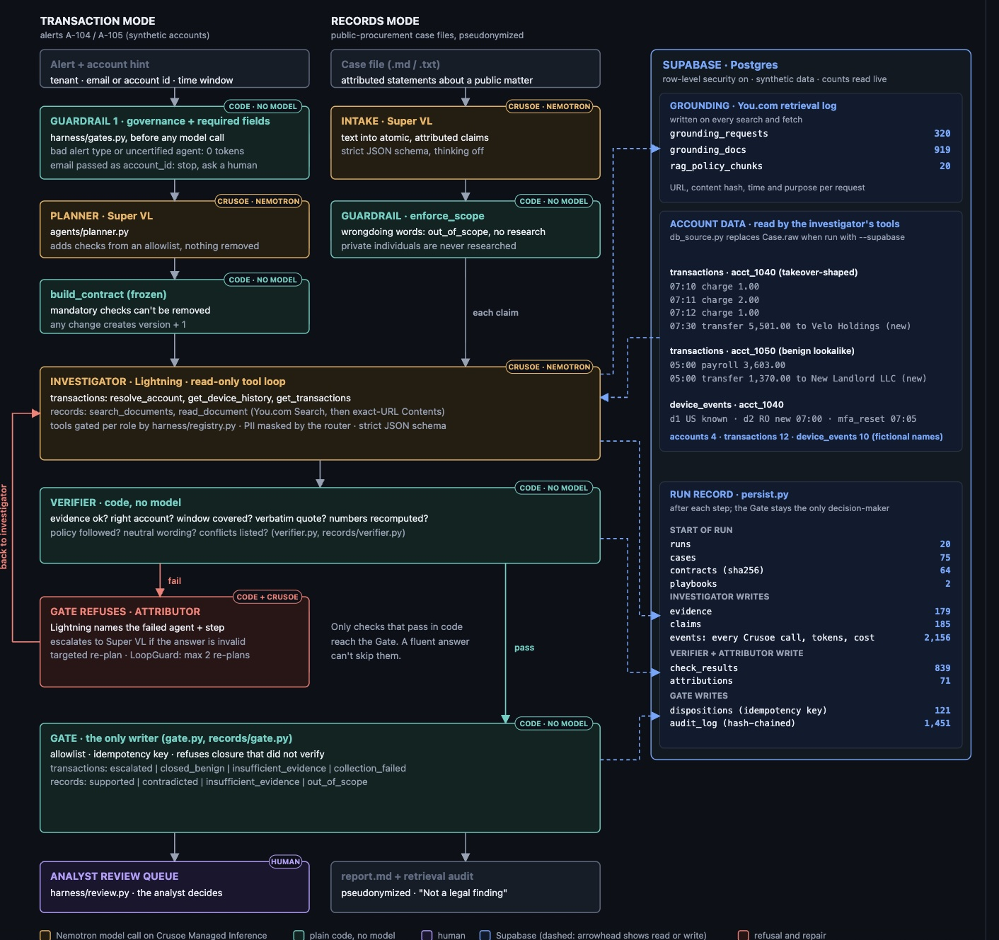
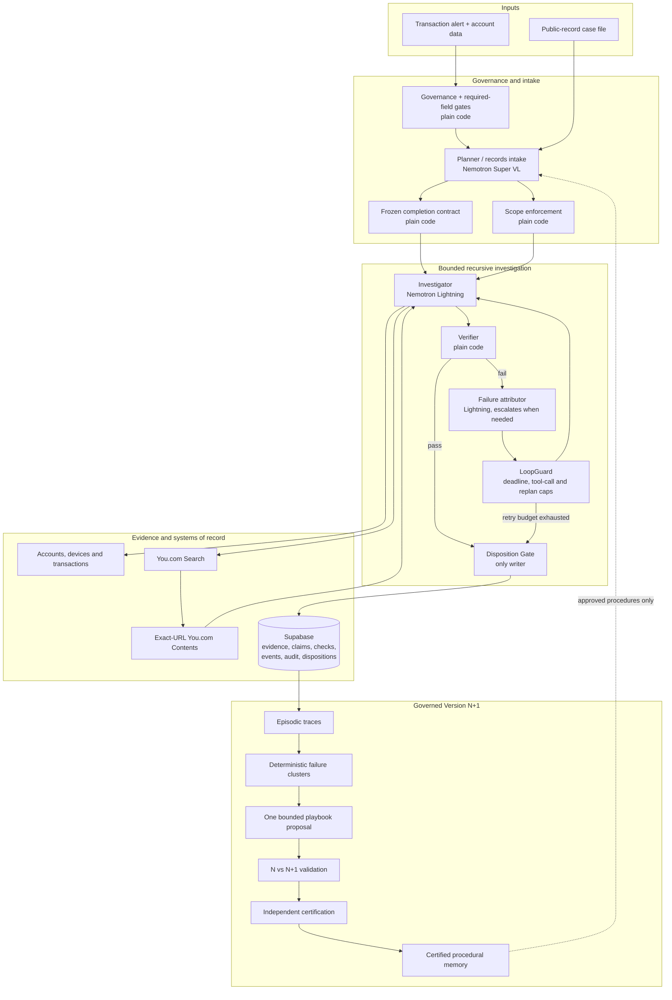

# Casefile

> **Live demo for judges: https://frontend-five-fawn-54.vercel.app/** (added after the build; replays recorded runs, no setup needed)

> **An agent that cannot prove it is done does not get to say it is done.**

Casefile is a governed recursive-agent system for verifying complex public-record claims and investigating suspicious transaction alerts. It was built for the **Crusoe x Cerebral Valley Recursive Agents Hackathon** and targets the **Done Means Done** problem statement, with a governed **Version N+1** learning loop as an extension.

Most research agents optimize for producing an answer. Casefile optimizes for proving that every required check was completed before an answer can be closed.

The language models investigate, plan, and attribute failures. Plain code freezes the definition of done, verifies the evidence, controls retries, and owns the final disposition.

## The problem

Important investigations rarely live in one database. A statement made in a hearing may need to be checked against a corporate filing, procurement award, subaward disclosure, campaign-finance record, regulation, audit report, or court document.

A conventional agent can still produce a confident report when:

- a source lookup failed;
- it cited a search page instead of the underlying document;
- the document concerns the wrong entity;
- a quote does not appear in the cited source;
- a date or amount was never recomputed;
- contradictory records were ignored; or
- an LLM critic merely agreed with another LLM.

Casefile treats those conditions as incomplete work—not as permission to guess.

## What Casefile does

Casefile currently supports two investigation modes that share the same fail-closed philosophy.

### 1. Records Mode: public-record claim verification

Records Mode accepts a hearing transcript, audit narrative, investigative report, or Markdown case file. It:

1. splits the narrative into atomic, attributed claims;
2. classifies each claim by the evidence it requires;
3. discovers candidate sources with You.com Search;
4. extracts content only from the exact accepted URL with You.com Contents;
5. attaches verbatim evidence spans and source provenance;
6. recomputes checkable dates, totals, and statuses in code;
7. returns a per-claim verdict; and
8. writes a pseudonymized report and retrieval audit.

Records Mode never decides whether a person committed fraud, corruption, or another offense. It determines whether a particular documentary assertion is supported by the collected record.

Per-claim verdicts are:

| Verdict | Meaning |
| --- | --- |
| `supported` | Adequate evidence satisfies every required code check. |
| `contradicted` | Adequate evidence supports the opposite of the checkable assertion. |
| `insufficient_evidence` | Sources responded, but the record cannot support a closed verdict. |
| `collection_failed` | Required evidence could not be collected. |
| `out_of_scope` | The claim asks for a legal conclusion, intent finding, or research about a private individual. |

### 2. Transaction Mode: evidence-complete alert investigation

Transaction Mode investigates synthetic account-takeover alerts using account identity, device history, beneficiary changes, authentication events, and transactions. A planner proposes additional checks, an investigator gathers evidence, and a deterministic verifier refuses a benign or escalated closure unless the frozen contract is satisfied.

Missing or failed evidence is never silently converted into “no suspicious activity.” If the loop cannot satisfy the contract, the case ends as `insufficient_evidence` or `collection_failed` and can enter the analyst review queue.

## Public-integrity demonstration cases

The real-world case files are **inputs to verify**, not facts endorsed by this repository. They exercise multi-registry research, exact-URL retrieval, attribution, quote matching, entity resolution, numeric recomputation, and honest uncertainty.

| Case file | Example records under review |
| --- | --- |
| [DHS advertising campaign](data/casefiles/public_integrity/dhs_ad_campaign.md) | Federal awards, corporate timelines, subcontract relationships, procurement policy, and hearing statements |
| [Fat Leonard / U.S. Navy](data/casefiles/public_integrity/fat_leonard.md) | DOJ charging and sentencing records, invoicing claims, contract steering, and attributed conduct |
| [Randy “Duke” Cunningham](data/casefiles/public_integrity/duke_cunningham.md) | DOJ records, defense-contract claims, asset transfers, and documentary allegations |
| [Mississippi TANF diversion](data/casefiles/public_integrity/mississippi_tanf.md) | State-auditor reports, nonprofit pass-through grants, claimed deliverables, and fund amounts |
| [Martin Kao / Navatek](data/casefiles/public_integrity/martin_kao.md) | Campaign-finance allegations, company identity, public filings, and investigative reporting |

The direct URLs for these cases were resolved and extraction-tested. One proposed DOJ OIG PDF was rejected because it concerned the removal of U.S. Attorneys and did not substantiate the Cunningham claims. That rejection is part of the product story: a real URL is not automatically relevant evidence. See [the public-integrity URL validation log](docs/PUBLIC_INTEGRITY_URL_VALIDATION.md).

Live retrieval runs completed so far:

| Case | Conservative result summary |
| --- | --- |
| Fat Leonard | 1 supported, 2 insufficient evidence, 1 out of scope |
| Duke Cunningham | 4 insufficient evidence, 1 out of scope |
| Mississippi TANF | 4 insufficient evidence, 1 out of scope |
| Martin Kao / Navatek | 1 contradicted, 2 insufficient evidence, 1 out of scope |

These are retrieval demonstrations, not benchmark accuracy claims. The conservative outcomes show that Casefile does not force a conclusion merely because a case file contains an allegation or a plausible URL.

## Architecture



*Amber boxes are Nemotron calls on Crusoe Managed Inference, teal boxes are plain code with no model, violet is the human analyst, and the blue panel is Supabase. The sample rows and row counts in that panel were read from the project's synthetic data on Oct 17 2026. Full-resolution version: [`docs/casefile_architecture_dark.svg`](docs/casefile_architecture_dark.svg).*

The same flow as a Mermaid diagram:



### Models propose; code decides

| Responsibility | Implementation |
| --- | --- |
| Records intake and transaction planning | NVIDIA Nemotron 3.5 Super VL on Crusoe Managed Inference |
| Evidence investigation and first-pass failure attribution | NVIDIA Nemotron 3.5 Lightning 30B A3B on Crusoe Managed Inference |
| Contract construction and allowed checks | Plain code |
| Evidence completeness, verbatim quotes, entity match, recomputation, neutrality | Plain code |
| Retry, deadline, and tool-call limits | Plain code |
| Final disposition and idempotent persistence | Plain code |
| Memory promotion | Independent approval plus code-enforced score and provenance rules |

All model IDs are resolved against Crusoe’s live `/v1/models` endpoint. The application does not guess an unavailable model ID, and model prices are read from the endpoint for cost accounting.

## Done Means Done

The completion mechanism has four parts:

1. **Frozen contract.** The Planner may add relevant checks or sources, but required checks cannot disappear after work starts.
2. **Deterministic verifier.** An LLM never decides whether the definition of done passed.
3. **Bounded repair.** A failed check is attributed to a specific agent step, and only that step is replanned. `LoopGuard` caps recursion.
4. **Single write gate.** The Gate is the only component allowed to commit a disposition. It is allowlisted, fail-closed, and idempotent.

For Records Mode, the verifier checks scope, verbatim quotations, source adequacy, entity identity, computed values, conflicts, and neutral language. For Transaction Mode, it checks the correct account, required evidence, time-window coverage, claim support, policy adherence, contradictions, and persistence.

## Governed Version N+1

Casefile’s N+1 design improves the investigation procedure without allowing the agent to lower its own safety bar.

```text
completed episodes
      -> deterministic verifier failures
      -> cluster by failed check and responsible step
      -> propose one narrowly scoped playbook edit
      -> compare Version N and N+1 on an untouched validation split
      -> reject on no gain or any safety regression
      -> independent human certification
      -> promote to procedural memory
```

The improver may change an investigator or planner playbook. It may not edit:

- policy;
- verifier checks;
- the tool permission registry;
- scope and neutral-language rules;
- the disposition Gate; or
- the evaluation oracle.

The repository already includes immutable episodic memory, certification gates for semantic and procedural memory, expiry and retirement controls, capped organizational retrieval, a Supabase memory schema and adapter, and an executable certification demo. Automatic failure clustering, paired N vs N+1 evaluation, and runtime promotion are still being connected. Until that paired evaluation exists, this README does **not** claim that N+1 has improved the held-out score.

See [Memory Certification](docs/MEMORY_CERTIFICATION.md) and run:

```bash
.venv/bin/python scripts/memory_certification_demo.py
```

## You.com grounding

The records pipeline uses a fail-closed two-stage retrieval path:

```text
claim -> You.com Search -> URL validation -> exact URL -> You.com Contents -> cached document
```

- Search discovers candidate URLs; its snippets are not treated as evidence.
- Code rejects Google search wrappers, generic search pages, unsupported schemes, and malformed URLs.
- Contents extracts only accepted direct URLs returned by Search or explicitly supplied in the case file.
- The Investigator reads from the resulting cache. A model-invented URL cannot become a scrape target.
- Every live run records accepted URLs, rejected URLs, queries, errors, retrieval timestamps, and document hashes.
- No result becomes `insufficient_evidence`; a collection transport failure becomes `collection_failed`.

You.com Finance is intentionally restricted. It may help identify a public issuer, locate a filing, or enrich a verified ticker/CIK. Procurement, grants, campaign finance, corporate registration, court records, and policy still require their actual systems of record. Finance enrichment is never treated as proof of misconduct.

## Supabase: durable evidence, outcomes, and memory

When Supabase credentials are configured, Casefile persists:

- runs, cases, and frozen contract hashes;
- typed account, device, and transaction inputs;
- every evidence receipt and model claim;
- every deterministic check result and failure attribution;
- compact model/tool events, token usage, latency, and cost;
- an idempotent final disposition;
- a hash-chained audit record;
- You.com grounding requests and versioned documents;
- reviewed policy chunks; and
- certified-memory candidates, certifications, retirement records, and routing decisions.

Without Supabase credentials, `Store` falls back to append-only JSONL in `data/store/`, which can be replayed later. The service-role key is backend-only and must never be exposed to a browser or committed.

See [the Supabase handoff](docs/SUPABASE_HANDOFF.md) and [`supabase/migrations/`](supabase/migrations/).

## Enterprise controls

The surrounding harness is deliberately more important than any single model:

- governance and required-field gates run before any model call;
- a central router enforces model allowlists, role access, per-case cost budgets, PII masking, and audit logging;
- a tool registry enforces per-role authorization;
- unsupported cases spend zero model tokens;
- typed state and append-only checkpoints support safe resume;
- the Planner never receives raw evidence text;
- evidence is untrusted data, never executable instruction;
- a hash-chained audit log detects modification;
- escalated and incomplete cases enter an analyst review queue;
- default reports are pseudonymized and include “Not a legal finding”; and
- no agent can move money, freeze an account, or make an adverse legal determination.

The criteria matrix, including known limitations, is in [Enterprise Criteria](docs/ENTERPRISE_CRITERIA.md).

## Quick start

### Requirements

- Python 3.11+
- a Crusoe Managed Inference API key for live model runs
- a You.com API key for live public-record retrieval
- optional Supabase project credentials for remote persistence

### Install

```bash
git clone https://github.com/<your-username>/casefile.git
cd casefile
python3 -m venv .venv
.venv/bin/pip install -r requirements.txt
cp .env.example .env.local
```

Add the Crusoe key to `.env.local`:

```dotenv
CRUSOE_API_KEY=...
```

Keep the You.com key in the gitignored `.env.youcom` file:

```dotenv
YDC_API_KEY=...
```

Optional Supabase backend configuration belongs in `.env.local`:

```dotenv
SUPABASE_URL=https://<project-ref>.supabase.co
SUPABASE_SERVICE_ROLE_KEY=...
```

Confirm the configured Crusoe models before a live run:

```bash
.venv/bin/python scripts/check_models.py
```

### Run an offline Records Mode example

The fixture path is reproducible and does not call You.com:

```bash
.venv/bin/python scripts/run_casefile.py \
  data/casefiles/example_procurement.md \
  --fixtures data/fixtures/example_procurement.json
```

### Run a live public-integrity case

```bash
.venv/bin/python scripts/run_casefile.py \
  data/casefiles/public_integrity/fat_leonard.md \
  --youcom \
  --include-domain justice.gov
```

The command writes a timestamped directory under `runs/` containing at least:

- `report.md` — pseudonymized claim-by-claim findings;
- `trace.jsonl` — agent, model, tool, token, latency, and cost events; and
- `retrieval_audit.json` — exact URLs, queries, rejections, and collection errors.

Use `--reveal` only when an authorized reviewer needs names in the local report.

### Run the Transaction Mode comparison

```bash
.venv/bin/python scripts/demo.py A-104 wrong_identifier
```

This compares an Investigator + LLM Critic against Casefile on a failure where an email is incorrectly passed to a tool that requires an account ID.

### Run the enterprise-control demonstration

```bash
.venv/bin/python scripts/enterprise_demo.py
```

The demo shows a recursive repair, a governance rejection with zero model calls, a required-field interrupt, PII masking, audit-chain verification, and the review queue.

## Benchmarks

Three configurations use the same cases, tools, model assignments, and budgets:

| Configuration | Description |
| --- | --- |
| C1 | Single Investigator |
| C2 | Investigator plus an LLM Critic |
| C3 | Casefile with frozen contract, code verifier, targeted repair, and Gate |

Run the transaction benchmark:

```bash
.venv/bin/python scripts/run_bench.py --split dev --configs C1,C2,C3
```

Run the synthetic records benchmark:

```bash
.venv/bin/python scripts/run_records_bench.py --split dev --configs C1,C2,C3
```

The latest documented transaction development run reported:

| Metric | C1 | C2 | C3 Casefile |
| --- | ---: | ---: | ---: |
| Correct disposition | 60% | 70% | 100% |
| False completion | 33% | 20% | 0% |
| Recovery from fixable faults | — | 75% | 100% |
| Cost per correct case | — | — | $0.0005 |

These are **development results**, not held-out results. Prompts were tuned after an earlier development run. The held-out split must be frozen and run once; numbers will be added here only after that evaluation completes. See [Pitch Prompts](docs/PITCH_PROMPTS.md) for the recorded run context and caveats.


## Investigation Console and measured N+1 (added Oct 17)

- `frontend/` is a dependency-free static console that replays recorded runs: per-claim grounding trail (query, documents You.com returned, exact document read, what Nemotron proposed, which code check rejected it, Gate commit), Supabase persistence counts and the N versus N+1 panel. Run `python frontend/build_data.py`, then open `frontend/index.html`.
- Supabase now carries structured evidence (`accounts`, `device_events`, `transactions`), per-run persistence (`src/casefile/persist.py`, `src/casefile/db_source.py`) and a per-case hash-chained `audit_log` (`scripts/audit_verify.py`, `scripts/audit_report.py`). `scripts/run_bench.py --supabase` persists a benchmark run. Integration tests: `pytest -m supabase` (needs credentials).
- N+1 experiment (`scripts/n_plus_1_demo.py`, synthetic mock mule-ring data): a new read-only fraud-engine tool (also exposed as an MCP server, `python -m casefile.fraud_engine_mcp`) plus policy `p2` and an improver-drafted playbook. Measured on 10 validation cases: N 7/10 correct with 3 false completions; N+1 7/10 correct with 0 false completions. The promotion gate **rejected** N+1 because correct dispositions did not strictly improve. This is not a held-out result, and policy `p1 -> p2` would need separate policy-owner approval.

## Third-party data generator

`third_party/sparkov/` is not committed (it is an upstream clone with its own history). Recreate it with `git clone https://github.com/namebrandon/Sparkov_Data_Generation third_party/sparkov` before running the Sparkov-based data scripts.

## Tests

Offline tests cover contracts, gates, verification, source routing, exact-URL enforcement, pseudonymization, neutrality, memory certification, Supabase persistence boundaries, audit integrity, prompt isolation, tool permissions, and benchmark split isolation.

```bash
.venv/bin/python -m pytest -q
```

Live tests require the corresponding credentials:

```bash
.venv/bin/python -m pytest -m live -q
```

## Pull-request compliance gate

`casefile-gate` is a separate MCP/CI compliance gate for repository changes. It checks PCI exposure, data classification, API-contract changes, tool-permission expansion, and regulatory surface. The decision is code-enforced and hash-chain audited.

```bash
git diff main | .venv/bin/python scripts/pr_gate.py \
  --change-id PR-12 \
  --summary "Describe the change"
```

See [Gate MCP](docs/GATE_MCP.md).

## Repository map

```text
src/casefile/
  agents/                 transaction planner, investigator, critic, attributor
  records/                records intake, investigator, source routing, verifier, Gate
  harness/                governance, router, registries, checkpoints, audit, memory
  bench/                  seeded dev/held-out cases and benchmark runners
  gate_mcp/               MCP/CI pull-request compliance gate
  orchestrator.py         transaction recursive loop
  persist.py              durable case, evidence, audit, and disposition writes
  store.py                Supabase/PostgREST client with JSONL fallback
  youcom.py               You.com requests, extraction, hashing, and grounding storage

data/casefiles/            synthetic and public-integrity records inputs
scripts/                   demos, benchmarks, ingestion, audits, and model checks
supabase/migrations/       versioned database schema
tests/                     offline and opt-in live verification
docs/                      design, specs, controls, evidence logs, and handoffs
```

## Current status and limits

| Capability | Status |
| --- | --- |
| Transaction investigation loop and deterministic closure | Built |
| Records claim splitting, verification, and pseudonymized reporting | Built |
| Live You.com Search → exact-URL Contents retrieval | Built and exercised on the public-integrity cases |
| Supabase case/evidence/check/event/disposition persistence | Built, with JSONL fallback |
| Working, episodic, semantic, and procedural memory rules | Built with certification demo |
| Supabase certified-memory schema and adapter | Built; runtime use is partial |
| Automatic N+1 proposal, paired validation, and promotion | In progress |
| Frozen held-out N vs N+1 result | Not yet claimed |
| Production authentication and signed agent identity | Not implemented |
| Automatic legal conclusions | Intentionally prohibited |
| Real customer banking data | Not used; transaction data is synthetic |

## Hackathon stack

- **Crusoe Managed Inference** — every runtime generative model call and live model/pricing discovery
- **NVIDIA Nemotron** — specialized Super VL and Lightning roles
- **You.com** — Search for source discovery, Contents for exact-URL extraction, and restricted Finance enrichment
- **Supabase** — durable inputs, evidence, claims, checks, audit events, outcomes, grounding, and certified-memory schema
- **Python, Pydantic, pytest** — typed orchestration, deterministic verification, and executable safety controls

## Documentation

- [Technical design](docs/DESIGN.md)
- [Records Mode specification](docs/RECORDS_SPEC.md)
- [Test plan](docs/TEST_PLAN.md)
- [Enterprise criteria](docs/ENTERPRISE_CRITERIA.md)
- [Memory certification](docs/MEMORY_CERTIFICATION.md)
- [Public-integrity source validation](docs/PUBLIC_INTEGRITY_URL_VALIDATION.md)
- [Data sources and policy grounding](docs/DATA_SOURCES.md)

## Responsible-use statement

Casefile is an evidence-completeness and claim-verification system, not a court, regulator, auditor, or legal decision-maker. Its outputs are research artifacts for qualified human review. A `supported` verdict means only that the retrieved record supports the narrowly written claim under the configured checks. It does not establish intent, liability, guilt, or the absence of other evidence.
